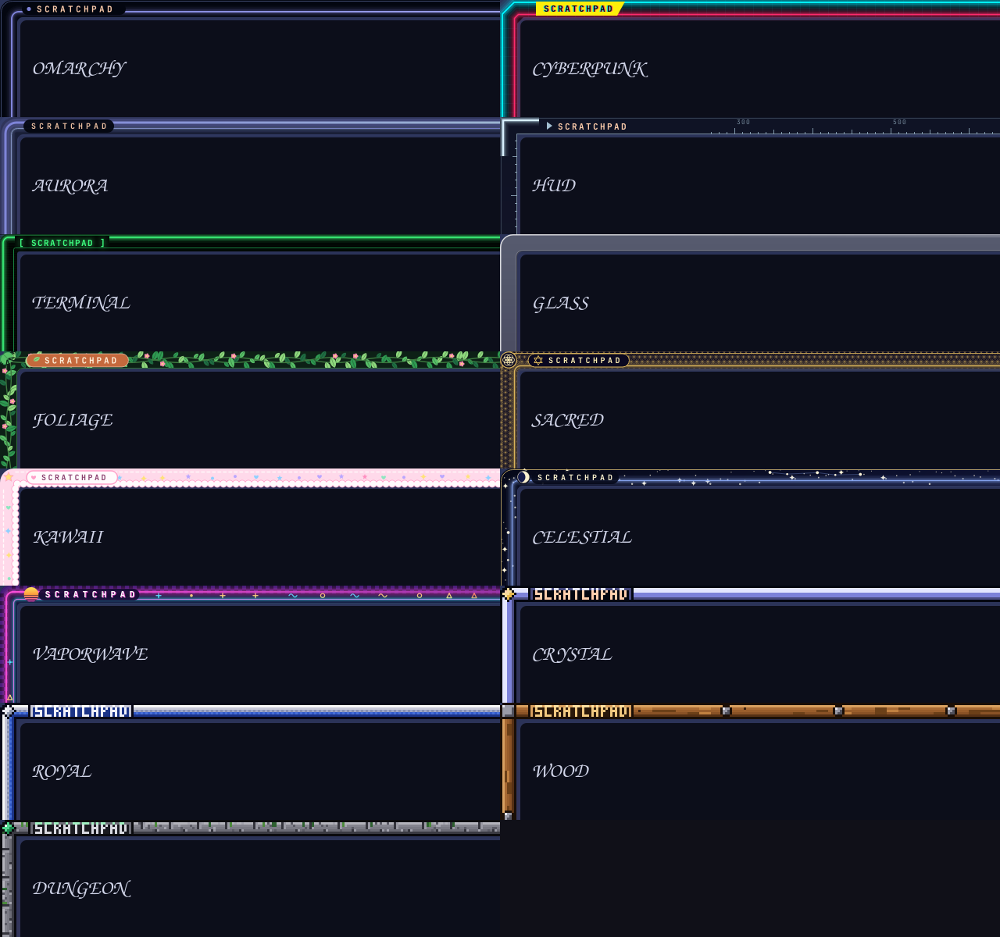
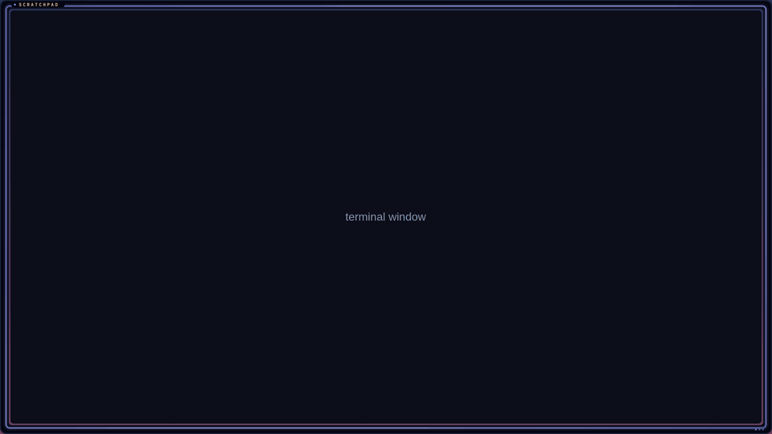
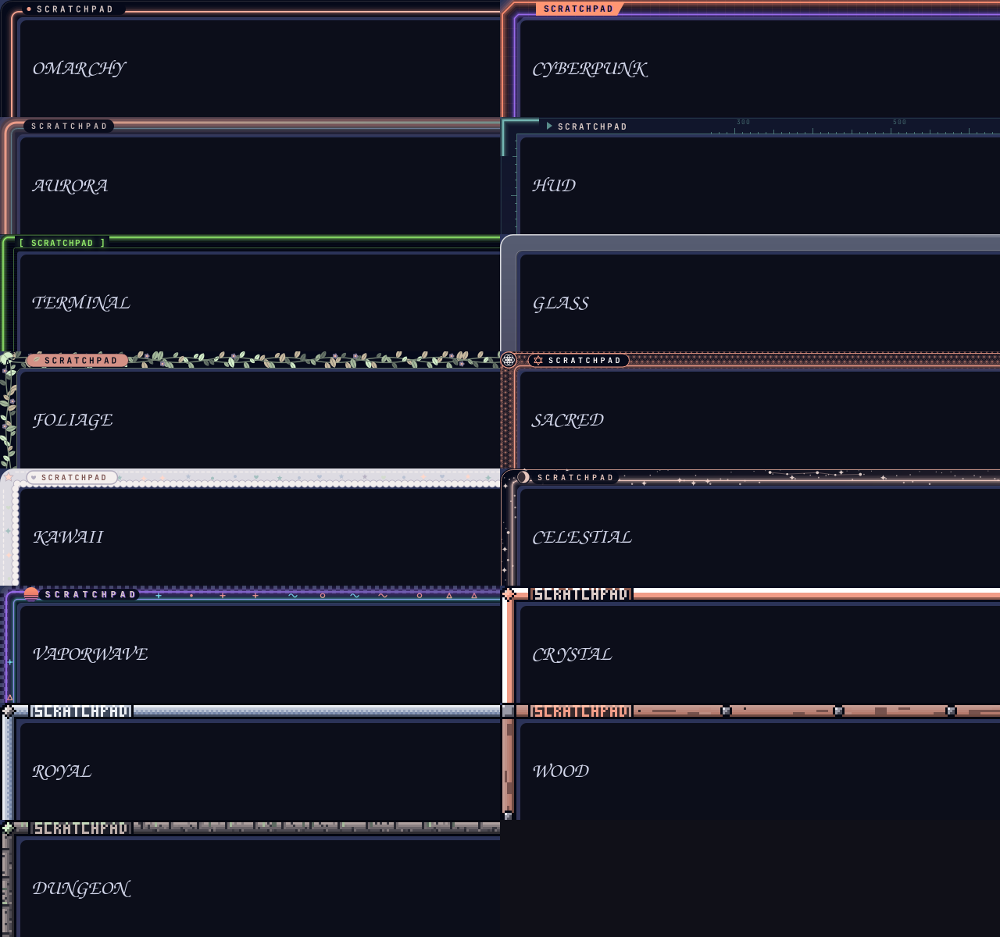

# Scratchpad Frame

<a href='https://ko-fi.com/akton1' target='_blank'></a>

A frame around the Omarchy scratchpad (`SUPER + S`). The frame slides in and out together with the scratchpad.





Forty-eight styles. The smooth ones (drawn in code, or from pictures in `assets/`):

| Style | Look |
| --- | --- |
| **Omarchy** | clean accent line, rounded, name pill, pager dots |
| **Cyberpunk** | chamfered neon cyan + magenta, circuit traces, hazard stripe, yellow tab |
| **Aurora** | soft glowing gradient ring |
| **HUD** | corner brackets, ruler ticks, coordinates, status readout |
| **Terminal** | phosphor-green double line, scanlines, prompt and cursor |
| **Glass** | frosted translucent bezel with a specular edge |
| **Foliage** | 16-bit jungle: layered pixel-art vines, flowers and elephant-ear leaves hang over the frame and spill into the window area (click-through), ferns along the bottom, mossy backdrop, wooden plank label |
| **Sacred** | gold flower-of-life lattice on indigo; great mandalas open from the corners and edge midpoints, a lotus rises from the bottom, halo glow inside the rim (click-through overlap) |
| **Kawaii** | pastel stitched ribbon with scalloped edge; a rainbow with clouds in the corner, a bunting garland, bubbles, clouds along the bottom and a cat peeking over the edge (click-through overlap) |
| **Celestial** | star-band sky with nebula washes, a big crescent moon, a ringed planet, a shooting star and constellations reaching into the window (click-through overlap) |
| **Vaporwave** | neon double line and checker edge; a perspective grid floor, striped sunset sun, neon palms and big memphis confetti over the window (click-through overlap) |
| **Sakura** | concept art cut into pieces on a drawn rail: pink blossom branches in the corners and on both sides over a dark lacquer rail with a gold rim and petal dots. Fitted to a small window the branches stick out 28 px past the rectangle |
| **Deep Sea** | water band with wave lines; light rays from the surface, swaying kelp forests, corals, a school of fish, jellyfish and rising bubbles (click-through overlap, thinner when fitted to a small window); outer contour: wave crest on top, bubble clusters on the corners, kelp blades on the sides and a sand bank below |
| **Steampunk** | riveted iron plate with brass trim; big meshing cogs in the corners, copper pipes with flanges and steam, a pressure gauge and a glowing lamp (click-through overlap) |
| **Frost** | ice-crystal snowflakes with icicles in the corners, a snowflake on each edge, on a frosted navy rail with crystal dots. Sticks out 28 px when fitted |
| **Halloween** | midnight band with orange stitching; cobwebs with hanging spiders, jack-o'-lanterns with vines, a full moon with a bat, ghosts and flying bats (click-through overlap) |
| **Cosmic** | neon cyan filigree corners with a violet planet and stardust on a dark space rail with star dots. Sticks out 28 px when fitted |
| **Megacity** | a dark cyberpunk city: steel truss band with a cyan strip-light rim, a girder across the top with hanging neon signs and sagging cables, tilted billboards, lit apartment blocks with a hazy far layer on the bottom edge, a glowing skybridge, flying taxis and a haze beam (click-through overlap) |
| **Gilded** | art nouveau gold: ornate gold vines, lilies and irises grow out of all four corners, a rosette medallion hangs from the top edge, a thin gold vine runs along an ink band (click-through overlap). The ornaments are pictures made with a local image generator (`assets/`, see below); follow mode tints them with your theme accent |
| **Runeforge** | game-UI frame: dark bronze rail with gold studs and rune plates, a glowing orange inner line, ruby-gem corner pieces and a carved bronze crest with a ruby hanging from the top edge. The frame is a picture (`assets/runeforge_frame.png`); follow mode tints it with your theme accent |
| **Nexus** | game-UI frame, sci-fi: carbon-fibre hexagon plate rail with a cyan light line, angular armour corner pieces and a tech crest. Same graphs as Runeforge (`assets/nexus_frame.png`) |
| **Embergoth** | game-UI frame, gothic: blackened iron rail with bone-white diamond inlays, thorned corner pieces and a crest with an ember-red gem. Same method (`assets/embergoth_frame.png`) |
| **Abyss** | game-UI frame, deep sea (replaces the busy Deep Sea look): dark teal rail with a thin glowing cyan chevron line, sea-glass corners with a pearl and a turquoise scale crest. Same method (`assets/abyss_frame.png`) |
| **Coral Reef** | four coral, kelp and gold-swirl corner pieces on a dark teal rail with pearls (`assets/coralreef_corners.png`). Fitted to a small window the corners stick out 28 px past the rectangle |
| **Hanami** | game-UI frame, cherry blossom: black lacquer rail with gold trim and tiny pink blossoms, rose lacquer corners with a gold wave edge, black and gold crest with a pink pearl. Same method (`assets/hanami_frame.png`) |
| **Wildwood** | game-UI frame, forest: dark carved-oak rail with green leaf knots and a glowing line, wooden corner pieces with green gems and a wooden crest. Same method (`assets/wildwood_frame.png`) |
| **Pasteup** | a city paste-up wall: a dark steel panel band (`assets/pasteup_band.png`) with orange status lamps, and small cut-out objects that overlap only a little into the window: masking tape, pink and yellow sticky notes, holographic stickers (`assets/pasteup_props.png`, placed by `tools/compose-props.py`). Follow mode tints the band only |
| **Blueprint** | drafting sheet: dimension lines, ruler strips and registration targets; sticks out past a fitted window |
| **Tidepool** | natural look, deep sea: photographed wet sea rock with a scallop shell, sea glass, a starfish, barnacles and kelp in the corners and top centre (`assets/tidepool_frame.png`) |
| **Cherrybark** | natural look, blossom: pink-brown peeling cherry bark with blossom twigs, petals and cherry leaves (`assets/cherrybark_frame.png`) |
| **Mosswood** | natural look, forest: thick moss on bark with moss clumps, ferns, oak leaves and mushrooms (`assets/mosswood_frame.png`) |
| **Driftwood** | weathered silvery-grey wood with grain and fine cracks, like a plain picture frame (`assets/driftwood_frame.png`) |
| **Slate** | dark layered slate with a bit of green-grey stone (`assets/slate_frame.png`) |
| **Leather** | brown leather with a hand-stitched edge (`assets/leather_frame.png`) |
| **Walnut** | materials: dark oiled walnut wood (`assets/walnut_frame.png`) |
| **Bamboo** | materials: pale green bamboo with fine fibres |
| **Birch** | materials: white birch bark with dark marks and peels |
| **Linen** | materials: natural beige linen weave with navy stitching |
| **Terracotta** | materials: warm unglazed orange clay |
| **Brick** | materials: weathered red brick with lime mortar |
| **Sandstone** | materials: golden desert sandstone with wind-carved layers |
| **Marble** | materials: white Carrara marble with soft grey veins |
| **Concrete** | materials: board-marked grey concrete |
| **Rust** | materials: rusted corrugated iron with flaking paint |

And the 16-bit pixel-art ones: **Crystal**, **Royal**, **Wood** and **Dungeon**.

### Follow Omarchy theme colors

The picker has a "Follow Omarchy theme colors" switch (press `F`, or select the row and press Enter). Off, each style uses its own palette (neon cyan for Cyberpunk, gold for Sacred, pastel pink for Kawaii...). On, every style recolours itself from your current theme, so the frame changes with `omarchy-theme-set`. Omarchy, Aurora, HUD, Glass and Crystal always use the theme.



```bash
omarchy-shell scratchpad-frame follow on       # on | off | toggle | status
```

The switch is saved in `~/.local/state/scratchpad-frame/follow`.

### Hide the title

The `SCRATCHPAD` label can be switched off (the picker's "Show title" row, or press `T`). The frame art stays; only the label goes. When you pick a style with `next`, `prev` or `set`, its name still flashes on the frame for a moment.

```bash
omarchy-shell scratchpad-frame title off       # on | off | toggle | status
```

The switch is saved in `~/.local/state/scratchpad-frame/title`.

### Fit the frame to the windows

By default a frame surrounds the whole scratchpad area. A scratchpad can instead frame just its windows: switch on "Fit the frame to the windows" on that scratchpad's page (bar icon, then the scratchpad), or from a terminal:

```bash
omarchy-shell scratchpad-frame.layers padSet notes fit on     # on | off, per scratchpad (the original one is "scratchpad")
```

The frame then hugs the box around all windows on that scratchpad (plus the 26 px gap the frame sits in) and follows them while you move or resize a floating window; Hyprland sends no event for that, so the windows are checked every 150 ms, and only while a fitted scratchpad is open. Tiled scratchpads fill the screen, so they look the same as before. An empty scratchpad keeps the full frame, and a very small window gets a frame of at least 120 px. Every style works, since each is painted for whatever size it is given; the styles with decorations drawn over the window area (Foliage, Sacred, Kawaii and friends) cover proportionally more of a small window.

### Styles that use pictures (assets)

A style can draw PNG pictures instead of (or on top of) vector shapes: **Gilded** does. The pictures live in `assets/`, the shell passes the folder to the painter as `o.assets`, and the style loads them with `artUrl(ctx, o, "name.png")` (see `gilded()` in `FramePainter.js`). Draw pictures first, then optionally tint them with a `source-atop` fill (that is how follow mode recolours Gilded), then draw the band over them.

**Runeforge, Nexus, Embergoth, Abyss, Hanami, Wildwood, Tidepool, Cherrybark, Mosswood, Driftwood, Slate and Leather** use one shared painter (`uiframe()`): the picture `assets/<style>_frame.png` is a 1920x1080 transparent frame that the painter cuts like a 9-slice, so corners and the top crest keep their shape at any window size and only the rails stretch along their length. Add a look by dropping a frame picture of that shape into `assets/` and adding one line to `UIFRAME` in `FramePainter.js` (file, corner size, crest height, trim colour, ink colour). Driftwood, Slate and Leather have no corner pieces or crest (corner size 30, crest 0): the material strip is simply mitred around the window.

**Frost, Sakura, Cosmic and Coral Reef** cut a picture into corner and edge pieces on a drawn rail (`pieced()` and `coralreef()`); **Pasteup** places small cut-out objects (`assets/pasteup_props.png`) over a thin band. All pictures are original artwork made with local image models whose licences allow commercial use of the output, cut out and shipped as PNG; the source sheets are not part of this repository.

The Gilded pictures are original artwork (gold ornaments generated with a local image model, cut out and faded to the corners); they are mirrored in code for the other corners.

## What's new

**1.5.0 (2026-10-14)**

- Fourteen new looks: the natural photo frames **Tidepool**, **Cherrybark**, **Mosswood**, **Driftwood**, **Slate** and **Leather**; the game-UI frames **Runeforge**, **Nexus**, **Embergoth**, **Abyss**, **Hanami** and **Wildwood**; plus **Blueprint** and **Coral Reef**. Frost, Sakura and Cosmic are redrawn from pictures.
- The bar icon opens the scratchpads overview; click a scratchpad to pick the frame for that one scratchpad, with a live preview on it only. Hover a style to preview, Enter or Space keeps it.
- Each scratchpad can slide in and out its own way (bottom or right, effects such as bounce, fade or instant); the frame follows.
- "Fit the frame to the windows": a small floating window gets a frame just around it, and styles can stick out past it.
- Styles load live: editing `FramePainter.js` or a picture in `assets/` shows at once, no shell restart.

**1.4.0**

- Scratchpads: the bar icon opens a window with every scratchpad as a card: name, key, how it moves, layout, apps started at login. Add scratchpads and give each its own key, way in, way out and startup apps.
- Connect: next to Fullscreen App Auto Workspace, when that plugin is installed.

## Install

```bash
omarchy plugin add https://github.com/AktOn1/omarchy-scratchpad-frame.git --enable
```

Plugins are added disabled by default. Review the code, then enable it:

```bash
omarchy plugin enable <plugin-id>
```

### Troubleshooting: `Target not found`

`omarchy-shell scratchpad-frame ...` answers `Target not found.` when the plugin is not running inside the shell yet.

1. Check it is enabled: `omarchy plugin list | grep scratchpad`. If it says `disabled`, run `omarchy plugin enable io.github.akton1.scratchpad-frame`.
2. Restart the shell once: `omarchy-restart-shell`. Then try `omarchy-shell scratchpad-frame state`.
3. The folder `~/.local/state/scratchpad-frame` does not exist after install. It is created the first time you pick a style or switch an option, so its absence is normal.

Still stuck? Open an issue with your Omarchy version (`omarchy version`) and the plugin lines from the shell log (`journalctl --user -b | grep -i scratchpad`).

## Scratchpad pops open after closing a flyout

When a bar flyout (any plugin menu with keyboard focus) closes, Hyprland gives focus back to the last focused window. If that window lives on a hidden scratchpad, Hyprland shows the scratchpad again. The plugin spots this (a focus change right before the scratchpad opens while a flyout of this shell is open or just closed) and hides it again at once. Layers of other programs (mascots, pills, chat overlays) never count as flyouts, neither when they open nor when they close, so SUPER + S is never affected by them. Overlays of the shell itself that never take keyboard focus (OmaShaders mouse effect, drag ghosts, OSD) and any layer that has been open for more than two minutes are ignored too. Turn it off with `omarchy-shell scratchpad-frame keepHidden off` (saved in `~/.local/state/scratchpad-frame/keep-hidden`).

## Scratchpad flies in from the other monitor

### How a scratchpad comes in and goes out

Each scratchpad has two steps, **coming in** and **going out**, and each has its own effect and its own side:

| Effect | What it does |
|---|---|
| Slide | Omarchy's own slide (its speed and curve) |
| Bounce, Springy | slides in and overshoots a little before it settles |
| Whoosh | a fast slide that brakes hard |
| Slow glide | a long, soft slide |
| Slide and fade | slides and fades at the same time |
| Fade | no movement, it fades in and out |
| Instant | no animation at all |

The side is **bottom** or **right**: Hyprland slides a scratchpad (a special workspace) only from the bottom or from the right, and ignores a "top" or "left" in the animation style. An older "top" or "left" in your settings counts as bottom or right. The way out starts as "same as coming in" and can be set on its own, for example in from the right and out through the bottom. The frame repeats the same step, so it stays on the windows. Set it from the pad's card, or `omarchy-shell scratchpad-frame.layers padSet <pad> effect|outEffect|direction|outDirection <value>` (`same` for the way out follows the way in).

A scratchpad that moves differently from Omarchy's own scratchpad gets its keys taken over by the plugin (the way `SUPER + S` already is for another side), so the right animation is set just before it toggles. A scratchpad that the plugin hides itself (the "keep hidden" option) goes out its own way too.

Open the scratchpad on one screen, hide it, open it on another: Hyprland moves its windows to the new screen's coordinates with the window move animation, so they fly in sideways from the old screen. The scratchpad keys (the Lua runtime in `akt.lua`) check, right before they toggle a pad, whether its windows still sit on another monitor than the one it opens on. If so, the window move animation is switched off for that toggle and put back afterwards exactly as configured (read from `hyprctl animations`), so only the normal slide-in is seen. Same-monitor toggles are untouched. Because of this the plugin also takes over Omarchy's own SUPER + S (same key, same toggle) whenever the window move animation is on; it gives it back when the plugin is disabled. Nothing to configure.

## Change the style

Open the picker: a centered list of style names. Up/Down (or j/k) move, Enter picks, `F` toggles theme following, `T` toggles the title, Esc closes, click picks. The frame previews the highlighted style while the menu is open.

```bash
omarchy-shell scratchpad-frame menu          # open / close the picker
omarchy-shell scratchpad-frame next          # cycle forward
omarchy-shell scratchpad-frame prev          # cycle back
omarchy-shell scratchpad-frame set CYBERPUNK # any name from `list`
omarchy-shell scratchpad-frame list
omarchy-shell scratchpad-frame current
omarchy-shell scratchpad-frame follow toggle # follow the Omarchy theme colours
omarchy-shell scratchpad-frame title toggle  # show / hide the SCRATCHPAD label
omarchy-shell scratchpad-frame keepHidden toggle # keep a hidden scratchpad hidden after a bar flyout closes (default on)
omarchy-shell scratchpad-frame state         # everything as JSON
omarchy-shell scratchpad-frame preview NEXUS # show a style live without saving (the bar menu uses this)
omarchy-shell scratchpad-frame previewEnd    # back to the saved style
omarchy-shell scratchpad-frame pads          # the scratchpads (name, label, direction, outDirection, effect, outEffect, style, fit) as JSON
omarchy-shell scratchpad-frame padsSet '{"pads": [{"name": "notes", "label": "NOTES", "direction": "right", "outDirection": "bottom", "effect": "bounce", "outEffect": "fade", "style": "GILDED", "fit": false}]}'
omarchy-shell scratchpad-frame.layers padSet notes fit on   # frame only the windows of one scratchpad
```

Optional keybind, add to `~/.config/hypr/bindings.lua`:

```lua
o.bind("SUPER + ALT + T", "Scratchpad frame style menu", "omarchy-shell scratchpad-frame menu")
```

The chosen style is saved in `~/.local/state/scratchpad-frame/style`.

## Bar icon and menu

Automation: `omarchy-shell scratchpad-frame.panel toggle|open|close`.

The plugin also ships a bar widget with its own frame icon. Add "Scratchpad Frame" in Bar settings (or add `{"id": "io.github.akton1.scratchpad-frame"}` to `bar.layout` in `~/.config/omarchy/shell.json`).

Click the icon to open the scratchpads overview (one card per scratchpad). Click a scratchpad to edit it: its settings (key, how it comes in and goes out, layout, startup apps) are at the top and its frame picker is right below them, in the same window: style groups, the styles of the group, a close-up preview. The choice is saved for that scratchpad only (its own style). There is no shared style to set in the window: pick a frame for each scratchpad you want one on (a scratchpad you never picked for keeps the style `omarchy-shell scratchpad-frame set` last chose). The scratchpad frame itself previews the highlighted style live, and leaving the page puts the real one back.

- Click a style to keep it. After a click in the picker, `h` `j` `k` `l` or the arrow keys move, `Enter` or `Space` keep the style, `Tab` jumps between groups, `1`-`9` pick a group, `g` / `G` jump to first / last, `f` follow desktop colors, `t` show title. Esc goes back to the cards.
- Right-click the icon for the next style, middle-click for a random one, scroll to step through the styles.

For a keybind: `omarchy-shell scratchpad-frame.bar toggle` (also `open` and `close`); `omarchy-shell scratchpad-frame.bar pick <scratchpad>` opens the window on that scratchpad's page. The big picker stays available as `omarchy-shell scratchpad-frame menu` (for a keybind).

## What it touches

- Draws one click-through, transparent layer-shell window per monitor.
- Reads `~/.local/state/omarchy/current/theme/colors.toml` (read only) for the theme-following styles.
- Runs `hyprctl eval` to widen `gaps_out` on `special:scratchpad` to 26 px so the frame sits in the gap, re-applies it when Hyprland reloads its config, and sets it back to your global `general:gaps_out` when the plugin is disabled or removed. It never edits your Hyprland config files.
- The bar widget runs `omarchy-shell scratchpad-frame ...` commands only; it reads the same style state file and `colors.toml`, and writes nothing of its own.
- Runs `hyprctl monitors -j` and `hyprctl getoption general:gaps_out -j` (read only).

Requires a Hyprland with Lua config support (`hyprctl eval`), as shipped with current Omarchy.

## Make a new style with your agent

The easiest way to get a style that fits your wallpaper or taste: let your coding agent (Claude Code, Codex...) write it. A style is one JavaScript function, so an agent can do it in one go.

1. **Get a reference.** Take your wallpaper, or have an image model make a concept picture of the frame you want (a moodboard with the colours and motifs). Keep the image in a folder the agent can read.
2. **Give the agent this prompt**, with the image path and a name filled in:

   > Read `README.md` and the `omarchy()` and `megacity()` functions in `FramePainter.js` in this plugin folder. Look at `<image>`. Write a new style `<NAME>` in `FramePainter.js` that uses its colours and motifs: paint inside the 22 px band on each edge, with optional click-through decoration over the window area. Also give it an outer contour: when `o.bleed > 0` (a frame fitted to a small window) draw a motif that sticks out of the rectangle (see "Outer contour" in the README) so the frame is not just a box, and add the style to `OUTER`. Support `o.follow` (colours from `palette(o.colors)`). Register it in `PAINTERS` only (the picker list is built from it) and add it to a group in `MenuModel.js`. Render it with `tests/render.qml` (see "Preview" below), look at the PNG and fix what looks off. Do not restart the shell: the running plugin picks up edits to `FramePainter.js`, `MenuModel.js` and `assets/` within about 2 seconds (see "Live reload").

3. **Check the preview**, ask the agent for changes ("less busy", "bigger signs", "match the cyan more"), then pick the style in the picker (`SUPER + ALT + T` if you bound it) or `omarchy-shell scratchpad-frame set <NAME>`.

Tips: ask for several variants (`NAME_A`, `NAME_B`), keep a style's motifs to a handful so it stays fast to draw, and remember a plugin update replaces `FramePainter.js`, so keep your own styles in a copy or a branch.

## Add your own style by hand

All drawing is in `FramePainter.js`. A style is one function `(ctx, W, H, o)` that paints inside a 22 px band on each edge (the plugin widens the scratchpad gap to 26 px). Register it in `PAINTERS`; it shows up in the picker automatically (under "More" until you add it to a group in `MenuModel.js`). `o.follow` tells you whether to use the style's own palette or colours derived from `palette(o.colors)`.

### Outer contour (frames that are not just a rectangle)

When a pad is fitted to a small window ("Fit the frame to the windows"), a style can also draw a little **outside** the rectangle: ears, brackets, tabs, vines, antlers, whatever suits it. Every new style should do this; a style that does not stays a plain rectangle.

- Add the style name to `OUTER` in `FramePainter.js` (`var OUTER = { OMARCHY: true, CYBERPUNK: true, MYSTYLE: true }`). Only styles in `OUTER` get extra room; the plugin grows the canvas by `BLEED` (28 px) on every side for them.
- In the painter, read `const B = o.bleed || 0`. `B` is 0 when the frame fills the screen (tiled pad, no fit) and `BLEED` when fitted. The origin stays at the rectangle's corner, so draw at negative `x`/`y` and past `W`/`H`, never more than `B` px out. Give `B = 0` the exact same look as before.
- Paint the outer shapes **before** the band, so the band covers their roots and they grow out of the frame instead of floating next to it. Keep them out of the window area (inside the 22 px band) and keep the strokes within `B`.
- The frame is clamped to the screen, so a window near the screen edge clips the outer parts there; do not rely on them being visible.
- Preview a fitted frame with `fit` as the last argument of the render command: it draws an 800x500 window with the frame hugging it.

See `omarchy()` (ears and edge tabs) and `cyberpunk()` (neon corner brackets) for two short examples.

Preview without a desktop session ("Preview"):

```bash
QML_XHR_ALLOW_FILE_READ=1 QT_QPA_PLATFORM=offscreen qml6 tests/render.qml -- /tmp/out MYSTYLE ~/.local/state/omarchy/current/theme/colors.toml [follow] [fit]
```

## Remove

```bash
omarchy plugin remove <plugin-id>
```

## License

MIT

## Support

Free and MIT licensed. If it is useful to you and you want to say thanks, you can [buy me a coffee on Ko-fi](https://ko-fi.com/akton1). Totally optional.

## Live reload

Adding or editing a style needs no shell restart. `StyleLive.qml` polls `FramePainter.js`, `MenuModel.js` and `assets/**/*.png` every 1.5 s (the shell runs without a file watcher), re-evaluates a changed script and repaints every frame, the picker list and the thumbnails. A pictures change bumps `o.rev`, which `artUrl()` adds to the image URL to bypass the Canvas image cache. A script with a syntax error is ignored (a warning in the shell log) and the previous version keeps running. Only a change to the QML files, `AktKit.js` or `manifest.json` still needs `./reload.sh`. Note: a new file under `assets/` deeper than one folder is not watched.
